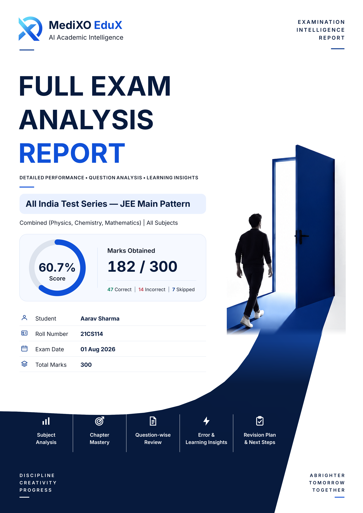

# MediXO EduX Premium Full Exam Analysis Cover — Implementation Report

## Result

Implemented the supplied open-door cover in the existing PDFKit Full Exam Analysis renderer. The cover is composed of native PDF text, vector rules, icons, score arcs and pathway shapes, plus one transparent local doorway/person illustration. The existing report renderer, interior components, question-media path and pagination system remain in place.

### Generated preview

- [300 dpi A4 cover PNG](MEDIXO_EDUX_PREMIUM_COVER_PREVIEW_300DPI.png)
- [Screen-scale cover PNG](MEDIXO_EDUX_PREMIUM_COVER_PREVIEW_SCREEN.png)
- [Generated full-analysis PDF used for the preview](MEDIXO_EDUX_PREMIUM_COVER_PREVIEW.pdf)

The generated PDF is 17 pages, A4 portrait (595.28 × 841.89 pt). Its first-page text remains selectable/searchable; the cover intentionally has no page folio. The page-one text extraction contains the dynamic JEE exam name, Aarav Sharma, roll 21CS114, 182 / 300, 60.7%, and 47 / 14 / 7 correct / incorrect / skipped counts.

## Implementation

- Replaced the former cover rendering call inside `renderFullAnalysis()` with the cover-only module and explicitly started a fresh interior page. The shared PDFKit renderer is unchanged; no alternate export pipeline or screenshot cover was introduced.
- Recreated the editorial hierarchy: actual logo and brand, top-right examination label, three-line navy/blue title, dynamic exam strip and scope, score panel, examinee rows, five feature items and restrained footer messages.
- Drew the score ring, dividers, rules, feature/student icons and sweeping lower pathway with PDFKit vectors. The pathway is a smooth native shape so it keeps the student details on white negative space while carrying through into the navy feature/footer area.
- Suppressed the standard running header/footer and page-total stamp only on the new Full Analysis cover. Interior pages retain the existing chrome and numbering.
- Added cover-specific examinee fields to the report model sourced from the examination payload, independently of the session-user fallback used by existing report/interior logic. This prevents a Faculty/Admin session name from becoming the examinee printed on the cover.
- Updated the independent PDF verifier for the intentionally numberless cover and its PDFKit-generated gradient backing images; the actual doorway image remains covered by the image/text-overlap check.

### Illustration asset

`frontend/src/assets/premium-cover-doorway.png` is a local 650 × 1100 RGBA asset. It was prepared from the supplied text-free 1024 × 1536 doorway poster by cropping the doorway/person region, removing near-white background pixels, fading the lower crop edge and resizing with Lanczos/unsharp masking. The source crop contains the open blue door, glow, walking person and floor; no baked report typography is included. The native pathway vector supplies the continuing geometric floor and bottom navy area.

The original illustration detail is approximately 120 dpi at its placed print size (the resized embedded bitmap is 240 dpi); it is sharp at screen and ordinary A4 viewing distance, but is not equivalent to a newly rendered 300 dpi photographic source. The existing MediXO logo asset is used unchanged.

The preparation utility is `frontend/scripts/prepare-cover-illustration.py` and takes the source poster path as its argument.

## Dynamic data mapping

- Exam title: `model.examName`.
- Examinee and roll number: payload-derived `coverStudentName` / `coverRollNo`; session-user identity is not used for the cover.
- Date: `model.examDate`, formatted as day, abbreviated month and year.
- Subject scope: active subject for a single-subject report; otherwise the model’s actual subject names and subject scope.
- Marks and total: `model.hero.score`, `hero.maxScore` / `hero.totalScore`, and `meta.totalMarks`.
- Percentage: calculated from actual score ÷ total marks when both are available; otherwise uses an existing payload percentage; when unavailable it displays an em dash and no score arc.
- Correct, incorrect and skipped counts: actual question-intelligence values (with existing hero fallbacks); each unavailable count is omitted rather than fabricated.

The cover is exercised against the canonical JEE payload and the refinement harness’s competitive-exam/NEET fixtures. Missing score/counts use the approved omission/em-dash fallback.

## Exact files changed

### Renderer, asset loading and data

- `frontend/src/pages/student/premium-pdf/cover.js` — new cover implementation.
- `frontend/src/pages/student/premium-pdf/full-analysis.js` — wires the cover into the existing Full Analysis entry point and starts the interior page.
- `frontend/src/pages/student/premium-pdf/components.js` — cover-only chrome suppression and numberless-cover pagination behavior.
- `frontend/src/pages/student/premium-pdf/model.js` — payload-only cover examinee/roll fields.
- `frontend/src/pages/student/premium-pdf/browser-assets.js` — browser loading of the illustration asset.
- `frontend/scripts/generate-report-pdfs.mjs` — Node report harness asset map.
- `frontend/scripts/generate-refinement-pdfs.mjs` — Node refinement harness asset map.
- `frontend/tests/pages/premium-pdf-pagination.test.js` — test renderer asset map.
- `frontend/tests/pages/premium-pdf-cover.test.js` — new dynamic-data and rendered-cover tests.
- `scripts/verify_refinement_pdfs.py` — numberless cover and gradient-overlap verification rules.

### New assets and deliverables

- `frontend/src/assets/premium-cover-doorway.png` — prepared local illustration.
- `frontend/scripts/prepare-cover-illustration.py` — reproducible asset preparation.
- `deliverables/MEDIXO_EDUX_PREMIUM_COVER_PREVIEW.pdf` — generated canonical Full Analysis PDF.
- `deliverables/MEDIXO_EDUX_PREMIUM_COVER_PREVIEW_300DPI.png` — print-resolution first-page preview.
- `deliverables/MEDIXO_EDUX_PREMIUM_COVER_PREVIEW_SCREEN.png` — screen-scale first-page preview.
- `deliverables/MEDIXO_EDUX_PREMIUM_COVER_IMPLEMENTATION_REPORT.md` — this report.

## Verification and regressions

- `npm run pdf:refinement` — passed. Generated the canonical reports, Student/Faculty/Admin Report and Full Analysis exports, figure QA report, and 180-question NEET QA report. Page counts matched the pre-change run: canonical Full Analysis 17; Student/Faculty/Admin Full Analysis 19 each; NEET full analysis 196 with 180/180 questions rendered.
- `scripts/verify_refinement_pdfs.py` — passed on the generated refinement set: 11 PDFs, 322 pages, 208 embedded figures; no verifier issues. The generated set was used for validation, then repository-tracked bulk refinement PDFs were restored so unrelated generated deliverables are not included in this cover-only change.
- Targeted Vitest: `premium-pdf-cover.test.js` and `premium-pdf-pagination.test.js` — **10 tests passed**. This includes the 180-question NEET completeness/pagination test, oversized continuation cases and the new cover checks.
- `npm run build` — passed. Vite emitted its existing large-chunk advisory; no build errors.
- Raster comparison against the pre-change PDF snapshot at 96 dpi: canonical Full Analysis and Student/Faculty/Admin Full Analysis pages 2 onward were pixel-identical. Their page counts are unchanged. Question-image and pagination code was not modified; the NEET test confirms all 180 question entries remain rendered.
- The synthetic figure and NEET stress PDFs retained their page counts and question completeness, but raster comparison found differences on 3 figure-QA interior pages and 18 NEET interior pages relative to the earlier generated snapshots, primarily dense question/explanation continuation pages. The question-rendering code was not changed, and canonical plus Student/Faculty/Admin production interiors were pixel-identical; the stress-fixture PDFs were restored rather than included. Their raster identity is therefore not claimed and should be investigated if those synthetic PDFs are treated as golden snapshots.
- A4 geometry and text extraction were checked on the generated PDF preview. The first page contains the expected dynamic examinee, marks and counts and has no `PAGE 01` folio.
- A full-suite test run had already shown 26 failures across 7 unrelated files before this implementation; the focused cover and pagination tests pass. The full suite was not rerun as a success criterion.

## Remaining limitations

- The doorway/person is a raster illustration rather than vector artwork; its effective source detail is about 120 dpi at placed size. Typography, scores, rows, icons, rules and pathway remain native PDF content.
- The existing brand logo itself is a raster asset, used without modification.
- Very unusually long examination names or subject lists may wrap more than the standard one/two-line presentation, but the cover derives text height from measured PDFKit layout and the tested competitive-exam fixtures render without layout-audit errors.
- The existing synthetic media harness reports 3 unavailable/unsupported figure attachments in the figure fixture and 16 in the 180-question NEET fixture, the same counts recorded before this change. PDF generation, pagination and question-completeness checks still pass.
