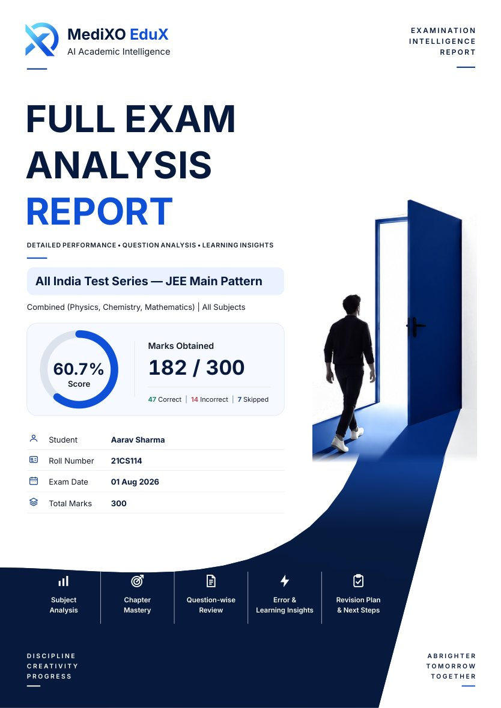
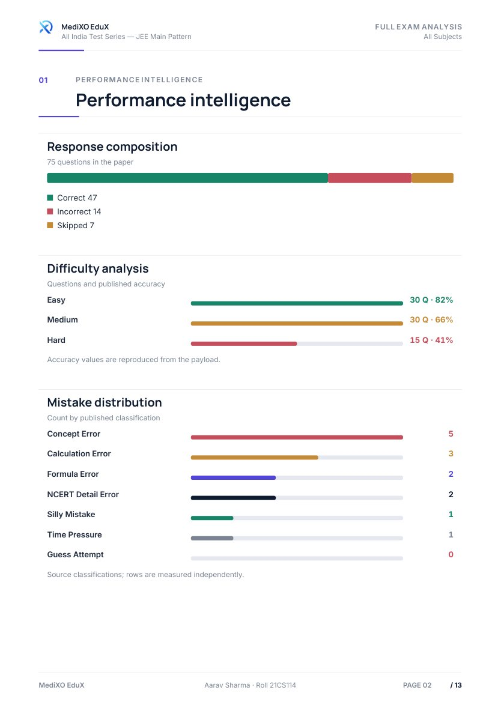
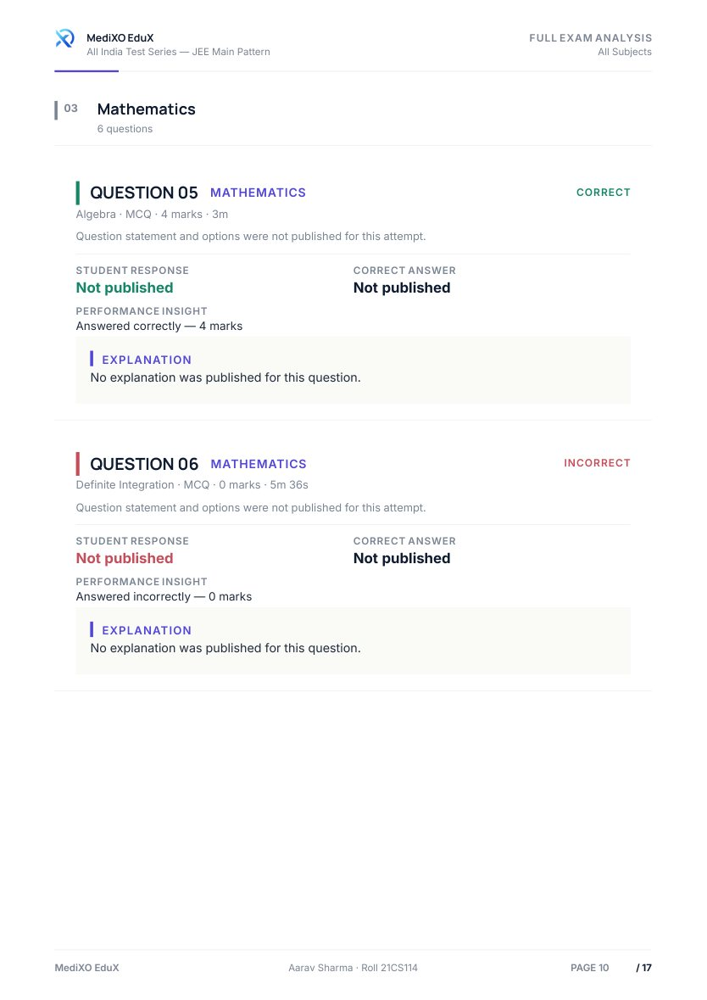
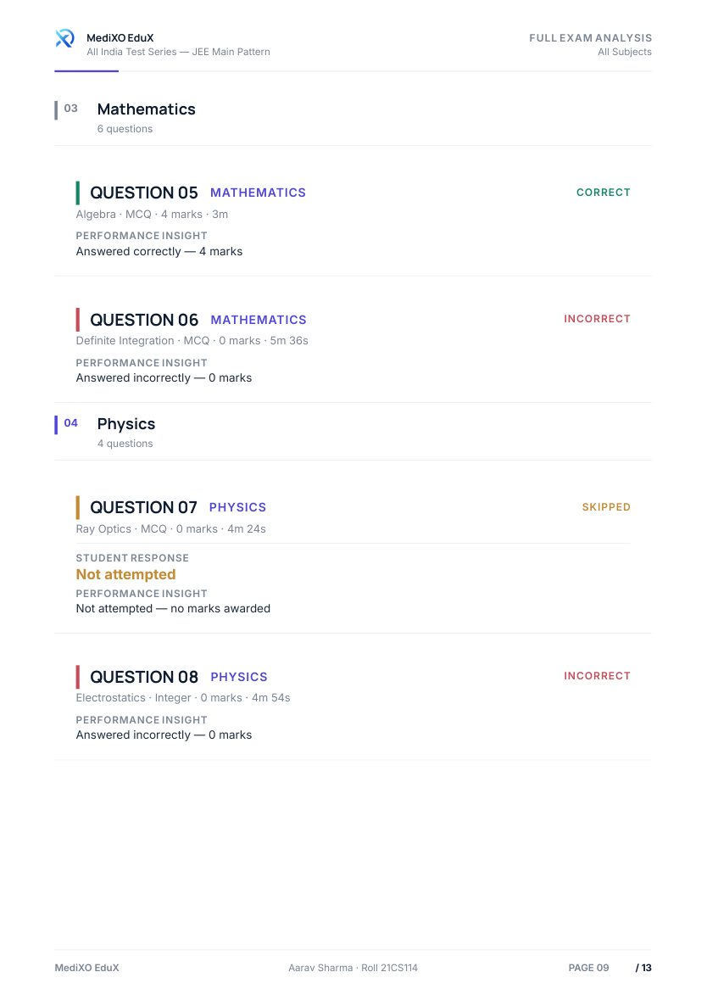
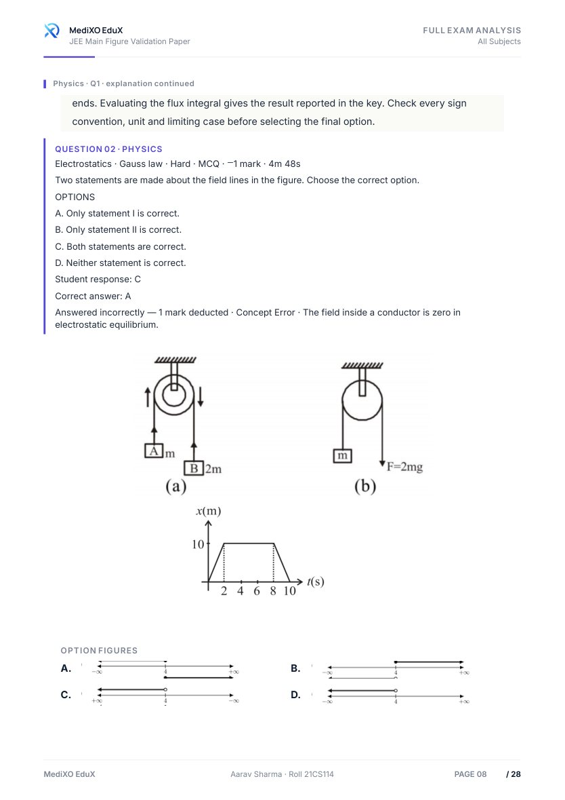
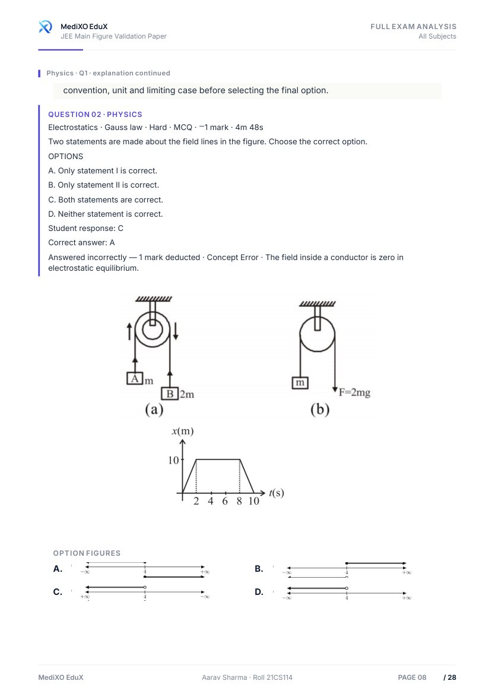
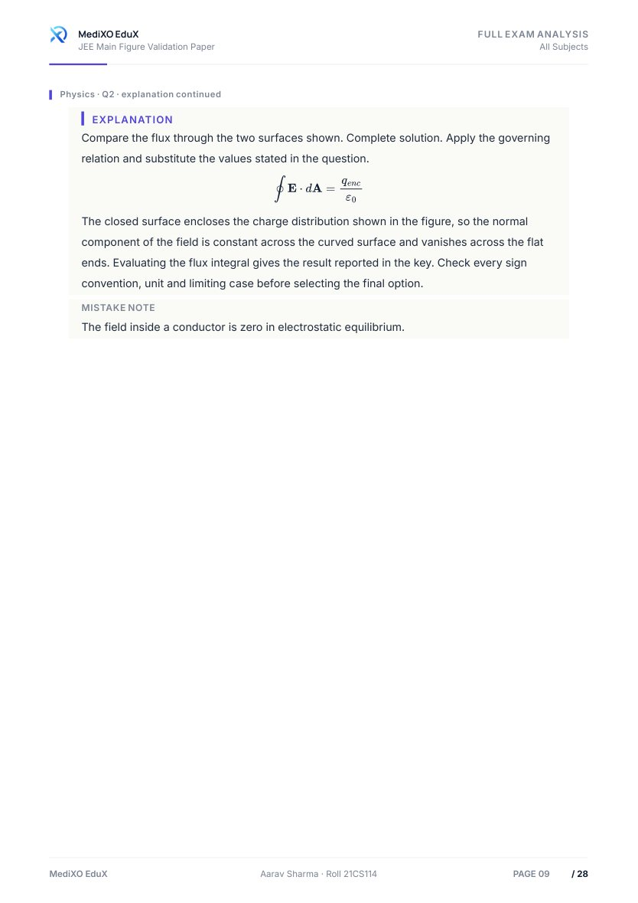
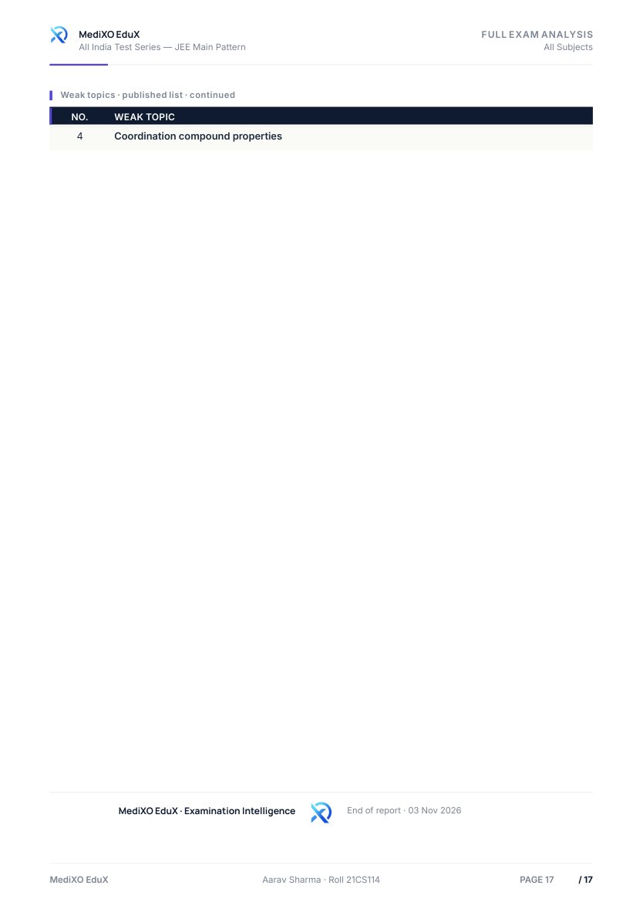
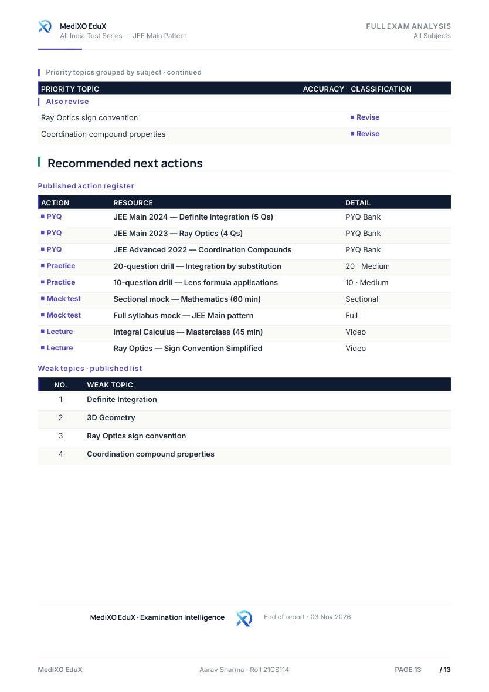

# MediXO EduX — Final PDF Content Refinement Report

**Branch:** `arena/e125c352-edux11`
**PDF engine:** existing Premium PDFKit pipeline
**Validation date:** 2026-11-03

## Executive summary

The Full Exam Analysis and Exam Intelligence PDFs now omit missing optional values instead of printing placeholder-only dashes, hyphens, underscores or repeated punctuation. Overall accuracy is derived from correct and incorrect results, with skipped questions excluded and score percentage kept separate. Question cards are more compact, tables drop empty rows/columns, the Intelligence report keeps subject performance vertically sequenced, and figure stacks now respect their measured height budget without changing aspect ratio.

The approved open-door cover is unchanged. Its rendered pixels match the preserved baseline exactly at 96, 144 and 192 DPI. The existing PDFKit engine, fonts, logo, colors, A4 pages, pagination architecture, role exports and question-image association were retained.

## Implementation and modified source files

- `frontend/src/pages/student/premium-pdf/accuracy.js` — reusable guarded accuracy and score-percentage helpers. It deduplicates complete question-result rows by question identity; when a detailed list is partial, it uses valid aggregate correct/incorrect counts. Skipped answers do not enter the denominator. Missing or zero-attempt data returns `null` accuracy rather than `NaN`, `Infinity` or a fabricated percentage.
- `frontend/src/pages/student/premium-pdf/base-model.js` and `model.js` — missing optional fields stay empty; overall accuracy is calculated from result counts; score percentage remains independent. Missing question answers, explanation text, times and metadata no longer receive display placeholders.
- `frontend/src/pages/student/premium-pdf/theme.js` — shared missing-token detection is limited to standalone placeholder tokens. Signed values, equations, scientific notation, hyphenated terms and source question text are not passed through broad punctuation cleanup.
- `frontend/src/pages/student/premium-pdf/components.js` — table rows and columns with no meaningful values are omitted; empty metrics are suppressed; question cards skip absent response/explanation blocks and remove unused vertical gaps while preserving content that exists. Measured pagination, continuation headers and figure-to-question/option association remain in place.
- `frontend/src/pages/student/premium-pdf/full-analysis.js` and `intelligence.js` — question-level accuracy is not rendered. Aggregate overall accuracy and meaningful subject-level accuracy remain. Intelligence subject metrics are displayed in one vertical column; the Intelligence report remains question-free.
- `frontend/src/pages/student/premium-pdf/figures.js` — height-budget scaling no longer stops at an arbitrary minimum scale that could exceed the available frame. Images scale proportionally, preserve source aspect ratio and remain paired with their question/option labels.
- `frontend/src/pages/student/premium-pdf/cover.js` — only missing-value branches were adjusted to omit absent values; no cover composition or layout was changed.
- `frontend/src/pages/student/premium-pdf/renderer.js` — figure coverage now distinguishes resolved source assets from figures actually drawn in the PDF; Intelligence reports correctly report zero question-figure placements.
- `frontend/scripts/generate-refinement-pdfs.mjs` and `scripts/verify_refinement_pdfs.py` — the validation harness records source-backed field coverage, skips question-media resolution for the question-free Intelligence report, and only requires response/correct-answer/explanation labels when those fields exist in the source.

### Tests added or updated

- `frontend/tests/pages/premium-pdf-accuracy.test.js` — aggregate accuracy, deduplication, partial review lists, skipped results, unavailable cases and score-percentage separation.
- `frontend/tests/pages/premium-pdf-figures.test.js` — width/height budgets and aspect-ratio preservation.
- Updated existing Premium PDF model, cover and layout tests for omitted missing values and the computed accuracy contract.

## Accuracy behavior

The requested example is covered by a unit test:

```text
correct 55 / incorrect 11 / skipped 9
attempted = 66
overall accuracy = 55 / 66 = 83.33%
```

For the canonical fixture, the complete aggregate counts available are 47 correct, 14 incorrect and 7 skipped. The report therefore shows **61 attempted** and **77.05% overall accuracy**. Its score percentage remains separate: **182 / 300 = 60.7%** as supplied by the score field. The canonical `questionReview` list is partial and does not contain question statements, options, correct answers or explanations, so those absent fields are omitted rather than fabricated.

## PDF export and stress-fixture results

All six role/action export combinations were regenerated and independently verified. Role exports render the 14 review rows supplied by their fixture; Intelligence remains concise and does not render question-by-question cards.

| Role | Full Analysis | Intelligence Report |
|---|---:|---:|
| Student | 16 pages; 14/14 review rows; 13 question figures embedded | 5 pages; no question-by-question analysis; 0 question figures embedded |
| Faculty | 16 pages; 14/14 review rows; 13 question figures embedded | 5 pages; no question-by-question analysis; 0 question figures embedded |
| Admin | 16 pages; 14/14 review rows; 13 question figures embedded | 5 pages; no question-by-question analysis; 0 question figures embedded |

Canonical PDFs: Full Analysis **13 pages** (down from 17); Intelligence Report **5 pages**. The Full Analysis page reduction is from compact question blocks and omission of empty metadata/table content; all 14 canonical review rows still render.

| Additional QA PDF | Result |
|---|---|
| Figure-rich Full Analysis | 18/18 questions rendered; 25 figure placements embedded; 3 source images failed to load |
| Figure-rich Intelligence Report | 4 pages; no question figures embedded, as intended for the concise report |
| NEET 180-question Full Analysis | **180/180 questions**, complete explanations/options retained, **196 pages**, 127 figure placements embedded and 16 source-image failures |

The three figure-fixture failures and 16 NEET image failures match the preserved pre-refinement generation results; they are source/media availability limitations, not new layout losses. Role Full Analysis figures all loaded (13 each).

## Validation results

- **Premium PDF tests:** 34 passed across 7 targeted test files, including the 180-question pagination stress test, question completeness, cover, figure sizing and clean-layout audits.
- **Production build:** `npm run build` passed. Vite emitted its existing advisory that some minified chunks exceed 1,200 kB; there were no build errors.
- **Independent PDF verification:** passed for **11 PDFs / 309 pages** using `deliverables/refinement/verification.json`. Checks include A4 geometry, page chrome, content availability, image/text overlap, single-column tables and layout audit integrity.
- **Extracted-text audit:** checked both canonical PDFs, all six role exports and all three QA PDFs. Found **no standalone placeholder-only lines**, no `NaN`/`Infinity`, and no question-accuracy labels.
- **Cover regression:** pre/post page-one raster output is pixel-identical at 96, 144 and 192 DPI.
- **Complete frontend suite:** 449 passed, 26 failed across seven unrelated UI/filter/adapter suites (`cascading-filters`, Student 360 SSR, phase-F adapters, sidebar active state, student dashboard, syllabus filter and UI copy cleanup). The targeted Premium PDF suite passes; these failures are outside the files changed for this refinement.

The verifier was run through `/home/user/content-venv/bin/python` because the system Python does not have PyMuPDF installed.

## Before/after visual previews

The preserved baseline PDFs are in `/home/user/pdf-content-baseline/`. The selected page previews below are stored in `previews/before-after/` alongside the final deliverables. The cover pair is pixel-identical. The question and figure pairs were inspected for completeness, label association, aspect ratio, clipping and continuation behavior.

### Approved cover (page 1)

| Before | After |
|---|---|
|  |  |

### First interior page (page 2)

| Before | After |
|---|---|
|  |  |

### Dense question page (before page 10; after page 9)

| Before | After |
|---|---|
|  |  |

### Figure-heavy question and explanation continuation (page 8 / page 9)

| Before | After |
|---|---|
|  |  |
|  |  |

### Final Full Analysis page (before page 17; after page 13)

| Before | After |
|---|---|
|  |  |

## Deliverable paths

- Full Analysis: `deliverables/refinement/MediXO_EduX_Full_Exam_Analysis_Report.pdf`
- Intelligence Report: `deliverables/refinement/MediXO_EduX_Exam_Intelligence_Report.pdf`
- Six role/action exports: `deliverables/refinement/exports/`
- Figure-rich and NEET QA PDFs: `deliverables/refinement/qa/`
- Generation results, layout audit and independent verification: `deliverables/refinement/generation-results.json`, `layout-audit.json`, `verification.json`
- Before/after image pairs: `deliverables/refinement/previews/before-after/`

## Limitations

The canonical and role-specific review payloads do not contain complete question statements, correct-answer values or explanations for every review row. These are omitted where absent; the renderer does not invent them. Three synthetic figure-fixture images and 16 NEET fixture images could not be loaded from the supplied media sources. The complete frontend suite also retains the 26 unrelated failures listed above. No limitation affects the preserved cover, the 180/180 NEET question count, or the independently verified pagination/layout checks.
